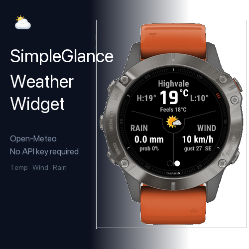
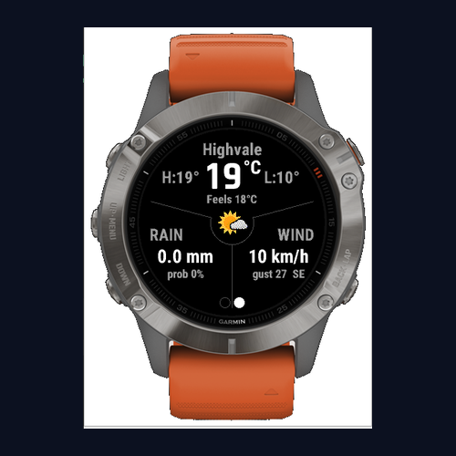
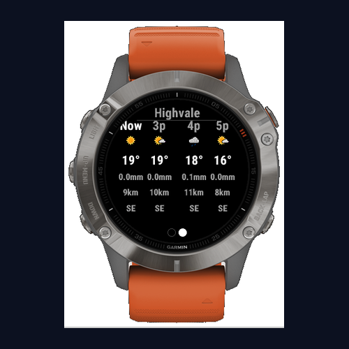
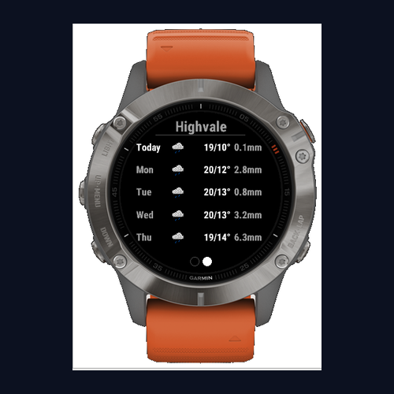
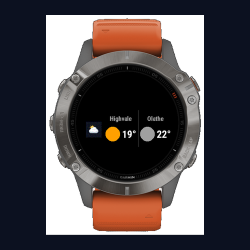

# SimpleGlance Weather Widget (Open-Meteo)



A clean, minimal weather widget for Garmin Fenix watches. Displays live conditions for two locations — your current GPS position and a configurable home location — with a single button toggle between them. Home starts as Brisbane CBD; change it in the settings, or clear both values and the Home page mirrors your current GPS location.

| Current Conditions | Hourly Forecast | Daily Forecast | Glance |
|:---:|:---:|:---:|:---:|
|  |  |  |  |

## Features

- Radial layout — temperature (top), rain (bottom-left), wind (bottom-right)
- Temperature, feels-like temperature, and today's high/low
- Wind speed, gust and compass direction (N, NE, …)
- Rainfall (current hour) and chance of rain
- Follows the watch's settings: °C or °F, km/h and mm or mph and inches (from the distance setting), 12- or 24-hour time
- **Hourly forecast** — weather icon, temperature, rain (mm), wind speed and direction for Now + 3 hours ahead
- **Daily forecast** — weather icon, high/low temperature and rain for Today + 4 days ahead
- Two-location toggle (GPS ↔ Home) with indicator dots showing active location
- **Glance view** — two-column strip showing GPS (left) and Home (right), the same order as the widget's dots, each with place name, current temperature and a condition word (with a coloured dot when it fits)
- Background refresh on a configurable interval (15 / 30 / 60 min)
- Offline cache — last known data shown instantly on launch; when a refresh fails, a "No connection · 14:05" line says how old the data on screen is
- No API key required — powered by [Open-Meteo](https://open-meteo.com) (free, no sign-up)

## Supported Devices

Fenix 6, Fenix 6 Pro, Fenix 6S, Fenix 6S Pro

## Navigation

| Button | Action |
|--------|--------|
| DOWN / UP | Next / previous page: Current Conditions → Hourly → Daily |
| SELECT | Toggle between GPS location and home location |
| MENU | Menu: **Refresh** (skipped if the data is newer than the refresh interval and you have not moved about 1 km), or **Set Home here** (saves your current position as Home, after a confirmation) |

The two dots at the bottom of every page show the active location: left dot = GPS, right dot = Home.

## Settings

| Setting | Default | Options |
|---------|---------|---------|
| Background Refresh Interval | 30 min | 15 / 30 / 60 min |
| Home Latitude | -27.4698 (Brisbane CBD) | Decimal degrees, −90 to 90 (e.g. -33.8688) |
| Home Longitude | 153.0251 (Brisbane CBD) | Decimal degrees, −180 to 180 (e.g. 151.2093) |

New installs start with Brisbane CBD as Home; updates keep whatever the watch already holds. While both values are blank, Home is not set and the Home page mirrors your GPS location. (Versions before 1.5.0 shipped preset coordinates; watches that still hold exactly that preset are also treated as "not set". Any other value, even nearby, counts as a real Home.) If a value is not a number, is out of range (latitude −90…90, longitude −180…180), or only one of the two is filled in, the Home page shows **Check Home settings in Garmin Connect** and no Home weather is fetched until it is fixed.

The quickest way to set Home is on the watch: press MENU, choose **Set Home here**, and confirm. Or change settings via the **Garmin Connect app** on your phone → My Device → Apps & Widgets → SimpleGlance Weather Widget.

## Architecture

See [ARCHITECTURE.md](ARCHITECTURE.md) for how the widget, glance and background parts fit together. Security and privacy notes are in [SECURITY.md](SECURITY.md) and [PRIVACY.md](PRIVACY.md).

## Building

Requires the [Garmin Connect IQ SDK](https://developer.garmin.com/connect-iq/sdk/) (8.1+) and a developer key. Keep the key outside the repo (the examples use `~/.garmin_dev.der`).

```bash
# Build for the simulator / a Fenix 6 Pro
monkeyc -o bin/simpleglanceweather.prg -f monkey.jungle -y ~/.garmin_dev.der -d fenix6pro -w

# Build package for all devices (upload to Connect IQ Store)
monkeyc -o bin/simpleglanceweather.iq --package-app -f monkey.jungle -y ~/.garmin_dev.der -w

# Run the unit tests (opens the Connect IQ simulator)
connectiq &
monkeyc -o /tmp/simpleglance-test.prg -f monkey.jungle -y ~/.garmin_dev.der -d fenix6pro -w --unit-test
monkeydo /tmp/simpleglance-test.prg fenix6pro -t

# Generate API docs from the //! comments (output outside the repo)
monkeydoc -c private -f "$HOME/Library/Application Support/Garmin/ConnectIQ/Sdks/<your-sdk>/bin/api.mir" -o /tmp/simpleglance-doc source/*.mc source/test/*.mc
```

Before a store release, run the hand-test script in [docs/TESTING.md](docs/TESTING.md) on a real watch.

Or use the [VS Code Monkey C extension](https://marketplace.visualstudio.com/items?itemName=garmin.monkey-c).

## Data Source

Weather data provided by [Open-Meteo](https://open-meteo.com) — free, no API key required.
Reverse geocoding provided by [Nominatim / OpenStreetMap](https://nominatim.openstreetmap.org) — free, no API key required.

## Known issues

- After a Home change, Home is labelled "Home" until a place-name lookup succeeds.
- Hour and day labels use the watch's time zone, not the location's.
- The hourly page always uses daytime icons.
- Freezing drizzle and freezing rain (WMO codes 56, 57, 66, 67) show the ordinary rain icons; the icon set has no freezing icon.
- In °F, temperatures are converted from whole °C, so they can be up to 1 °F off.
- When Home changes from not set to set, the Home page shows the GPS data under the GPS name until the first Home reply arrives (usually a second or two).
- The "No connection" line and message only cover failures since the widget was opened; a failed background refresh is not shown.

## License

© 2026 Mahoneyclan. SimpleGlance is free software, released under the
[GNU General Public License v3.0](LICENSE) (GPL-3.0). You may share and change
it under that licence; it comes with no warranty.

The weather icons are the Met.no weathericons set, taken from
[BleachDev/Rainy](https://github.com/BleachDev/Rainy) and also licensed GPL-3.0.
The full source is at https://github.com/Mahoneyclan/simpleglance-weather-widget.
